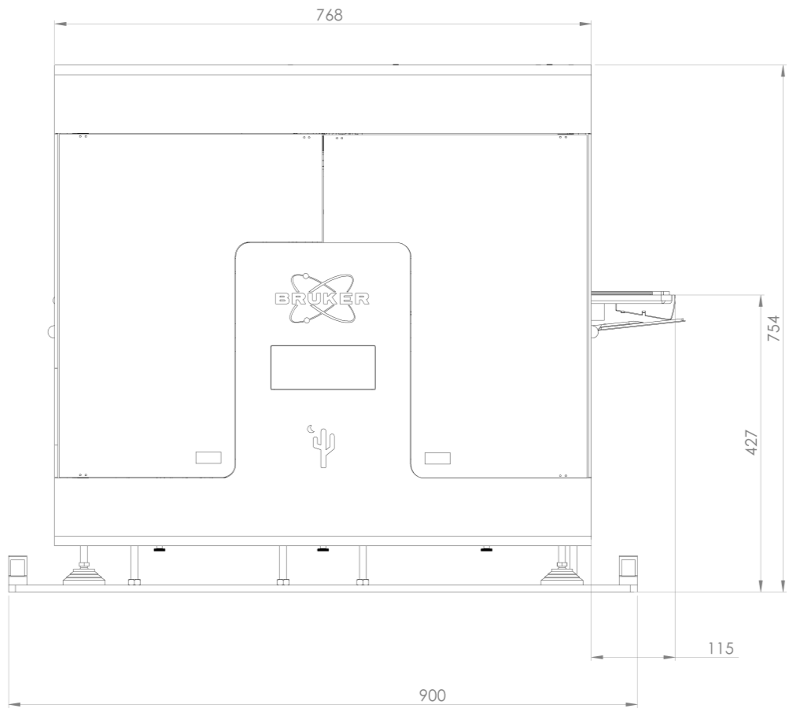
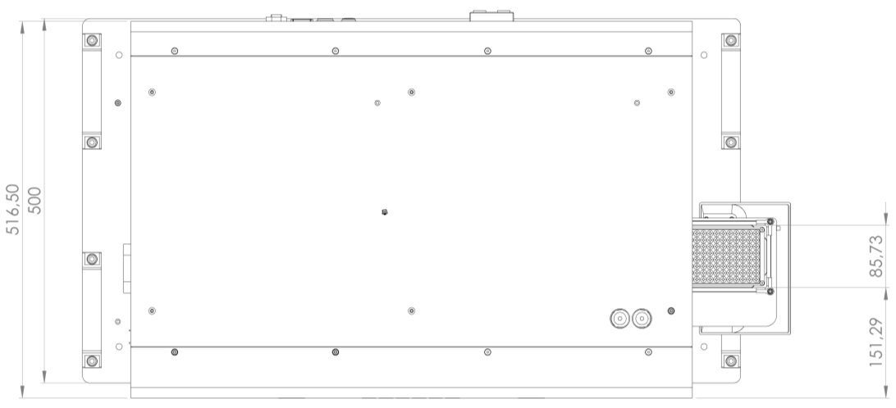

# Device Geometry

The geometry of the device is shown in Figure 1. All distances are given in millimeters. The plate tray for the sample plate can be moved out to the right side of the device, so the plate can be exchanged by a plate robot controlled by a lab automation framework. There is also space for a plate on the left side of the device, however, the current software does not support to exchange it at runtime.

## Figure 1: Geometry of the device

