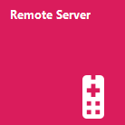

# Remote-Control Mode

Before a client can connect to the API, the Control Software must be switched to the remote-control mode. This mode disables most buttons of the user interface so a user in front of the device cannot interfere with the remote client's commands. The user can only check the status of the device and look at the data. The control software opens a server to which a client can connect. The current user is logged of from the control software when the server is started since the remote-control mode uses a dedicated user account with special permissions.

The remote-control mode is started by clicking the "Remote Server" tile on the Control Software's home screen.

You will get to a new page where you can see a graph with the application's recorded data and a log table showing messages that are exchanged between server and client. Once the server is started, all navigation buttons of the user interface are blocked, and it is not possible to leave the page while the server is running.

Message boxes that are displayed during the regular operation of the Control Software are intercepted and handled by the server to avoid that the software gets blocked while a dialog is shown. Dialogs that allow more than one possible answer can be configured in the file "RemoteServiceDialogResults.xml" which is part of the Control Software's installation.
